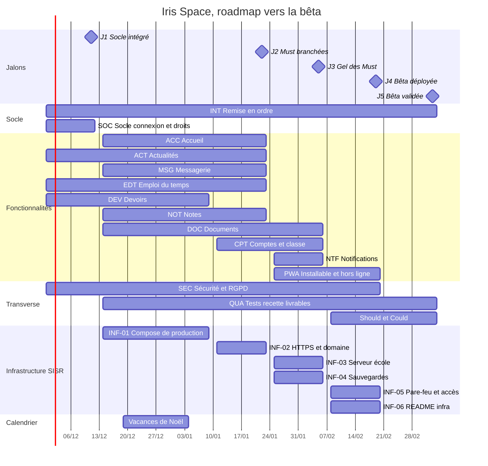
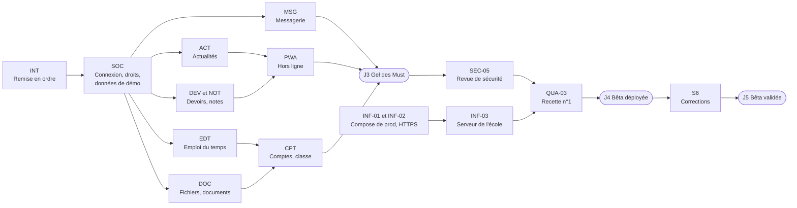

# 03 — Roadmap

## Hypothèses

- L'équipe SLAM compte 5 personnes : Matthieu, Maïlys, Louis, Thomas et Teva (décision D1). L'équipe SISR (Mehdi Ennar, Mehdi Seghier, Safwen Lachhab) mène l'infrastructure en parallèle.
- Chaque personne donne environ 6 h par semaine au projet (une journée), soit 12 h par sprint de deux semaines. La charge prévue ne dépasse jamais 12 h par personne et par sprint, et tourne autour de 8 h en moyenne : le reste couvre les relectures, les bugs et les estimations trop optimistes.
- Les sprints durent deux semaines, du lundi au vendredi. Le sprint 2 englobe les vacances de Noël. Si les vacances d'hiver tombent pendant un sprint, on le décale d'autant.
- La bêta est visée pour début mars 2027, ce qui laisse une marge avant l'oral (date à confirmer, décision D2).
- Le cahier des charges renvoie à un Gantt sous Notion, que nous n'avons pas pu consulter. Cette roadmap peut le remplacer, ou y être importée avec [taches.csv](taches.csv).

## Vue d'ensemble

Le diagramme s'affiche sur GitHub. Les barres montrent les tâches Must de chaque lot, regroupées.

## Jalons

| Jalon | Date | Atteint quand… |
|---|---|---|
| J1 — Socle intégré | ven. 11/12/2026 | `develop` contient le front et le back ; `docker compose up` lance tout ; admin, prof et élève se connectent avec la vraie API et voient leur menu |
| J2 — Must branchées | ven. 22/01/2027 | actualités, messagerie, emploi du temps (consultation et gestion), devoirs élève et prof, notes élève et documents admin marchent avec l'API, sans mocks |
| J3 — Gel des Must | ven. 05/02/2027 | toutes les fonctionnalités Must sont codées (saisie des notes, ressources prof, comptes, voir la classe, notifications dans l'application, PWA installable et hors ligne) ; après cette date, plus de nouvelle Must |
| J4 — Bêta déployée | ven. 19/02/2027 | la bêta tourne en HTTPS sur le serveur de l'école, la double authentification marche pour les admins et les profs, la revue de sécurité est faite, la première séance de recette avec Mme Hamidat et M. Khedaiji a eu lieu |
| J5 — Bêta validée | ven. 05/03/2027 | les retours de recette sont corrigés, le README est final, la version `v1.0.0-beta` est étiquetée sur `main` |
| J6 — Oral | à confirmer (D2) | support de présentation prêt, démonstration répétée |

## Sprints

### S1 — Remise en ordre et socle (30/11 → 11/12/2026)

À la fin du sprint (J1) : une seule branche `develop` à jour, `docker compose up` lance tout, les trois rôles se connectent avec la vraie API. En parallèle, la page Devoirs élève est construite sur les mocks.

| Qui | Tâches | Charge |
|---|---|---:|
| Thomas | INT-01 Fusion de `backend` dans `main` · INT-05 Contrat d'API unique · SOC-02 Droits renvoyés par le back · SOC-03 Connexion côté front · SOC-07 Vérification du socle · SEC-01 Cookie de session et erreurs | 12 h |
| Maïlys | INT-04 README unique · SOC-01 Données de démo · SOC-06 Relais `/api` dans nginx | 9 h |
| Louis | INT-02 Fusion de la branche front de Louis · INT-03 Branche Vie scolaire · DEV-01 Service devoirs · DEV-02 Page Devoirs élève | 11 h |
| Teva | SOC-04 Client API · SOC-05 Mocks alignés sur le back · EDT-03 Consultation de l'EDT branchée | 7 h |
| Matthieu | INT-06 Hygiène du dépôt · ACT-02 Écarts actualités ↔ base · PM-01 Animation du projet | 5 h |

### S2 — Routes manquantes (14/12/2026 → 08/01/2027, vacances de Noël comprises)

À la fin du sprint : les routes actualités, messagerie, emploi du temps admin et fichiers existent et sont testées ; l'élève voit ses vraies notes et son vrai emploi du temps ; la page Devoirs prof existe.

| Qui | Tâches | Charge |
|---|---|---:|
| Thomas | DOC-01 Routes fichiers · QUA-01 Collection de tests de l'API | 8 h |
| Maïlys | MSG-01 Routes messagerie · MSG-02 Règles de la messagerie | 9 h |
| Louis | DEV-03 Page Devoirs prof · NOT-01 Notes élève branchées | 11 h |
| Teva | ACC-01 Accueil élève et prof branché · EDT-01 Routes emploi du temps admin | 11 h |
| Matthieu | ACT-01 Routes actualités · PM-01 Animation du projet | 8 h |
| SISR | INF-01 Compose de production | 3 h |

### S3 — Branchement des Must (11/01 → 22/01/2027)

À la fin du sprint (J2) : actualités, messagerie, emploi du temps, devoirs et documents admin marchent avec l'API.

| Qui | Tâches | Charge |
|---|---|---:|
| Thomas | DOC-02 Documents admin branchés · DOC-04 Documents élève et « Mes documents » · CPT-07 Profil selon le rôle | 10 h |
| Maïlys | MSG-03 Messagerie branchée · SEC-02 Limite des tentatives | 9 h |
| Louis | NOT-02 Saisie des notes (prof) | 8 h |
| Teva | ACC-02 Tableau de bord admin · EDT-02 Gestion de l'EDT branchée · QUA-02 Intégration continue | 11 h |
| Matthieu | ACT-03 Actualités branchées · ACT-04 Image d'actualité · ACT-05 Formulaire Contact · PM-01 Animation du projet | 8 h |
| SISR | INF-02 HTTPS et domaine | 6 h |

### S4 — Espace prof, comptes, PWA (25/01 → 05/02/2027)

À la fin du sprint (J3) : toutes les Must sont codées. Ensuite, on ne fait plus que corriger, sécuriser et déployer.

| Qui | Tâches | Charge |
|---|---|---:|
| Thomas | PWA-01 Manifest · PWA-02 Service worker · PWA-03 Hors ligne et installation | 10 h |
| Maïlys | CPT-06 Mot de passe · NTF-01 Notifications créées par le back | 7 h |
| Louis | DOC-03 Ressources prof · CPT-03 Voir la classe | 9 h |
| Teva | CPT-01 Page Comptes (admin) · NTF-02 Cloche de notifications | 11 h |
| Matthieu | SEC-04 RGPD · PM-01 Animation du projet | 7 h |
| SISR | INF-03 Serveur de l'école · INF-04 Sauvegardes | 12 h |

### S5 — Sécurité, déploiement, recette (08/02 → 19/02/2027)

À la fin du sprint (J4) : la bêta tourne en HTTPS sur le serveur de l'école, la double authentification marche pour les admins et les profs, la revue de sécurité est faite, la recette n°1 a eu lieu. La charge prévue est plus faible : le temps restant sert à corriger ce que la revue et la recette trouvent.

| Qui | Tâches | Charge |
|---|---|---:|
| Thomas | INT-07 Appui au déploiement · PWA-06 Essais sur appareils | 6 h |
| Maïlys | SEC-03 Double authentification | 8 h |
| Louis | DEV-05 Pièces jointes d'un devoir (S) · CPT-05 Photo de profil côté back (S) | 5 h |
| Teva | CPT-02 Page Programme (admin) (S) · SEC-05 Revue de sécurité | 9 h |
| Matthieu | CPT-04 Profil modifiable (S) · SEC-06 Bandeau cookies (S) · QUA-03 Recette n°1 · PM-01 Animation du projet | 11 h |
| SISR | INF-05 Pare-feu et accès · INF-06 README infra | 5 h |

### S6 — Corrections et Should (22/02 → 05/03/2027)

À la fin du sprint (J5) : retours de recette corrigés, README final, version `v1.0.0-beta`. Même remarque : le temps non planifié sert aux corrections.

| Qui | Tâches | Charge |
|---|---|---:|
| Thomas | INT-08 Version bêta étiquetée | 1 h |
| Maïlys | MSG-04 Pièces jointes (C) · QUA-06 README final | 5 h |
| Louis | DEV-04 Correction des devoirs (C) · VSC-01 Vie scolaire branchée (bonus) (C) | 8 h |
| Teva | QUA-04 Accessibilité (S) | 4 h |
| Matthieu | QUA-05 Support et démo · PM-01 Animation du projet | 8 h |

### Après J5, jusqu'à l'oral

- Notifications push (PWA-04, PWA-05) et double authentification des élèves (SEC-07), reportées après la bêta (décisions D4 et D5).
- Tâches Could restantes, corrections, éventuel passage chez un hébergeur externe (INF-07).
- Préparation de l'oral : support, démonstration chronométrée, répétitions.

## Chemin critique

Une flèche veut dire « doit être fini avant ». Un retard sur INT ou SOC retarde tout le reste : c'est pourquoi le sprint 1 leur est consacré.

## Risques

Repris de l'analyse des risques du cahier des charges et mis à jour avec l'état réel du projet.

| Risque | Probabilité | Impact | Réponse |
|---|---|---|---|
| Le front et le back ne s'emboîtent pas. C'est déjà arrivé : deux listes de routes différentes. | élevée | élevé | Un seul contrat d'API (`ROUTES.md`, INT-05). Chaque fonctionnalité portée par une seule personne, de la route à la page. Test avec la vraie API avant chaque fusion. |
| Retard sur la bêta | élevée | élevé | Les Must d'abord, gel des Must à J3, Should et Could ensuite seulement. Jalons vérifiés à chaque revue de sprint. |
| Le périmètre dérive : vie scolaire et MediaSchool ont été construits hors cahier des charges | moyenne | moyen | Rien de nouveau sans l'accord de Mme Hamidat (décisions D3 et D6). |
| Le back repose sur une ou deux personnes | moyenne | élevé | Chaque poste écrit ses propres routes, relecture croisée des PR, `ROUTES.md` tenu à jour. |
| Hébergement ou HTTPS pas prêts à temps (équipe SISR) | moyenne | élevé | INF-01 dès S2. Docker en local documenté, pour pouvoir présenter même sans serveur. |
| Faille de sécurité : aujourd'hui, pas de limite de tentatives de connexion ni de double authentification | moyenne | très élevé | Lot SEC, revue de sécurité (SEC-05) avant J4. |
| Code écrasé ou données perdues | faible | très élevé | `main` et `develop` protégées, PR obligatoires, `DROP SCHEMA` sorti du script principal (SOC-01), sauvegardes (INF-04). |
| Absence prolongée d'un membre | faible | moyen | Fiches individuelles et identifiants de tâches pour qu'une autre personne reprenne. Chaque tâche critique a un relecteur qui la connaît. |

## Rituels de suivi

- **Point hebdomadaire** (15 min, au début de la séance projet) : chaque personne dit ce qui est fini, ce qui vient ensuite et ce qui bloque. Un blocage est signalé tout de suite sur sa carte, avec sa cause (cours 2).
- **Revue et planification de sprint** (45 min, le vendredi de fin de sprint) : démonstration de ce qui marche avec la vraie API, mise à jour de [01](01-etat-des-lieux.md) et de cette roadmap, choix et réestimation des tâches du sprint suivant.
- **Démonstration à la commanditaire** aux jalons J2 et J4.
- **Compte rendu** après chaque revue (cours 3) : situation, écarts entre prévu et réalisé, décisions, prochaines étapes. À ranger dans `docs/gestion-projet/comptes-rendus/`, nommé `AAAA-MM-JJ_IrisSpace_CR-sprint-N.md`.
- **Indicateurs** (cours 2), calculés à chaque revue : taux de tâches terminées (tâches terminées ÷ tâches prévues × 100) et écart de charge des tâches finies (heures réelles − heures estimées).
